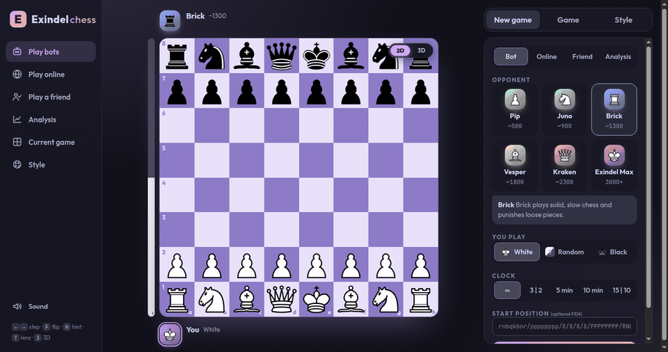

# Exindel Chess ♟️

A modern, fast, and feature-rich chess platform featuring interactive 3D and 2D boards, Stockfish bot personalities, a live tactical coach, threat lens, and online multiplayer.

🎮 **[Play Live Demo](https://nazmulislam-lab.github.io/Chess_ORCA/)**



---

## ✨ Features

### 🌟 Dual 3D & 2D Board System
* **Stunning 3D Visuals**: Procedural Staunton chess pieces (lathe-turned bodies, hand-crafted knight profiles) with weighted green felt pads and PBR materials.
* **Realistic Wood Surfaces**: Procedural wood grain textures on tiles with individual chamfered inlays that catch studio lighting and soft shadows.
* **Camera Controls**:
  * **Free Orbit & Zoom**: Click and drag across the board to rotate; scroll wheel or pinch to zoom.
  * **Angle Presets**: Quick camera angles on the stage HUD (**3D Perspective**, **Cinematic Angle**, and **Top-Down Tactical**).
  * **Camera Reset**: Smooth return to standard framing (**⟲**).
  * **Board Flip**: Press `F` to smoothly orbit the camera to the opponent's view.
* **Interactive Feel**:
  * Selected pieces smoothly lift and hover with dynamic shadows.
  * Tile hover highlights and cursor state changes over legal moves.
  * Gentle capture animations where captured pieces sink and dissipate gracefully.
* **Instant 2D/3D Switcher**: One-click **`[ 2D | 3D ]`** toggle directly on the board stage HUD or via the `3` key.

---

### 🤖 Stockfish AI Personalities
Play offline against Stockfish 19 compiled to WebAssembly running directly in your browser:
* **Pip** (~500 Elo): Learning the rules; makes casual mistakes.
* **Juno** (~900 Elo): Developing basic tactics and piece coordination.
* **Brick** (~1300 Elo): Solid, patient positional style; punishes loose pieces.
* **Vesper** (~1800 Elo): Aggressive tactical attacking style.
* **Kraken** (~2300 Elo): Relentless precision and ruthless endgame technique.
* **Exindel Max** (3000+ Elo): Uncapped grandmaster engine calculation.

---

### 🧠 Live Coach & Analysis Engine
* **Move Classification**: Every move is graded with instant badges:
  * ★ **Best** · ! **Excellent** · ✓ **Good** · ?! **Inaccuracy** · ? **Mistake** · ?? **Blunder**
* **Live Evaluation Bar**: Real-time advantage meter (`+0.5`, `-2.1`, `M3`).
* **Evaluation Graph**: Visual trajectory showing advantage swings and momentum across the entire game.
* **Coach Commentary**: Explanatory notes detailing why a move was strong or what tactical opportunity was missed.
* **Plan Preview**: Press `H` to view recommended multi-move continuation arrows on the board.

---

### 🔍 Tactical Threat Lens
* Press `T` to activate the **Threat Lens**:
  * Shading highlights board square control (**Blue** for White, **Red** for Black).
  * Danger rings highlight hanging or insufficiently guarded pieces.

---

### 🌐 Game Modes
* **Play Bots**: Practice against custom AI personalities.
* **Play Online**: Real-time room match-making with invite links via WebSockets.
* **Play a Friend**: Local pass-and-play on the same device.
* **Analysis**: Sandbox board with FEN import/export and move explorer.

---

### 🎨 Themes & Customization
* **Board Color Themes**: Orchid, Lagoon, Ember, Graphite, Mocha, Sakura.
* **Accent Colors**: Mauve, Teal, Peach, Blue, Green.
* **Assistance Toggles**: Live Coach, Threat Lens, Legal-move dots, Board coordinates, Auto-flip on turn.

---

## ⌨️ Keyboard Shortcuts

| Key | Action |
| :--- | :--- |
| `←` / `→` | Step backward / forward through game history |
| `Home` / `End` | Jump to start / latest live position |
| `F` | Flip board perspective (White ⇄ Black) |
| `3` | Toggle between 3D and 2D board |
| `T` | Toggle Threat Lens |
| `H` | Show Plan preview / Hint arrows |
| `Ctrl+Z` / `Cmd+Z` | Takeback (undo move) |
| `Esc` | Deselect piece / dismiss modals |

---

## 🛠️ Tech Stack

* **Frontend**: Vanilla JavaScript (ES Modules), HTML5 Canvas, modern CSS.
* **3D Engine**: [Three.js](https://threejs.org/) (OrbitControls, RoomEnvironment PBR, PCF Shadow maps).
* **Chess Rules & Engine**: [`chess.js`](https://github.com/jhlywa/chess.js) + [Stockfish 19 WebAssembly](https://stockfishchess.org/).
* **Backend Server**: Node.js HTTP server & WebSocket (`ws`) for multiplayer games.
* **Tooling**: [Vite](https://vitejs.dev/).

---

## 🚀 Getting Started

### Prerequisites
* [Node.js](https://nodejs.org/) v20 or higher
* npm or pnpm

### Installation

1. Clone or navigate to the repository:
   ```bash
   git clone https://github.com/your-username/chess-orca.git
   cd chess-orca
   ```

2. Install dependencies:
   ```bash
   npm install
   ```

### Running Locally

* **Start the Vite Dev Server (with hot module reload):**
  ```bash
  npm run dev
  ```
  Open [http://localhost:5173](http://localhost:5173) in your browser.

* **Start the Full Multiplayer Server (WebSockets + static serving):**
  ```bash
  npm run build
  npm start
  ```
  Open [http://localhost:8787](http://localhost:8787) in your browser.

---

## 📦 Project Structure

```text
Chess_ORCA/
├── assets/             # Demo GIF and graphics
│   └── demo.gif
├── public/             # Static public assets
│   ├── engine/         # Stockfish WASM binary & worker script
│   └── demo.gif
├── server/             # Node.js server with WebSocket multiplayer
│   └── index.js
├── src/                # Core application source
│   ├── board3d.js      # Three.js 3D board, procedural pieces & camera
│   ├── engine.js       # Web Worker wrapper for Stockfish
│   ├── main.js         # Game state, bot AI, coach, HUD & events
│   ├── online.js       # Client WebSocket connection for multiplayer
│   ├── pieces.css      # SVG 2D piece graphics
│   ├── sound.js        # Synthesized audio effects
│   └── style.css       # Theme styles, glassmorphic HUD & layouts
├── index.html          # Main HTML structure & stage HUD
├── package.json
└── vite.config.js
```

---

## 📄 License

ISC License. Stockfish engine is licensed under GPLv3.
